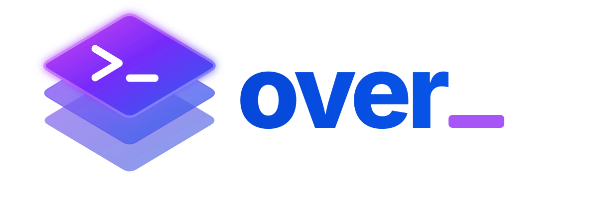

<p align="center">
  
</p>

<p align="center"><strong>A git-based file overlay manager (dotfiles as overlays)</strong></p>

<p align="center">
  <a href="https://github.com/noirbizarre/over/actions/workflows/ci.yaml">
    
  </a>
  <a href="https://codecov.io/gh/noirbizarre/over">
    
  </a>
  
  <a href="https://noirbizarre.github.io/over/">
    
  </a>
  
</p>

---

Over manages files as overlays: directories in a Git-backed source repository
whose contents are applied to target directories. It is particularly well-suited
for dotfiles. Compose reusable app overlays into host setups, inherit policy
through descriptors, and choose file symlinks, directory symlinks, editable
checkouts, or managed blocks to fit your workflow.

<p align="center">
  
</p>

## Installation

### Homebrew (macOS/Linux)

```sh
brew install noirbizarre/tap/over
```

The formula provides macOS amd64/arm64 and Linux amd64 binaries. For Linux
arm64, use the glibc release artifact listed below.

### Arch Linux (AUR)

```sh
yay -S over-bin   # prebuilt binary
# or, to build from source:
yay -S over
```

### cargo-binstall

`over` isn't published to crates.io, so a plain `cargo install over` won't
work — but prebuilt binaries are available through
[`cargo-binstall`](https://github.com/cargo-bins/cargo-binstall):

```sh
cargo binstall over
```

### Download a binary

Download a binary for your platform from the
[latest release](https://github.com/noirbizarre/over/releases/latest).

**Release artifacts:**

| Platform | Architectures | Runtime variant |
| --- | --- | --- |
| Linux | amd64 | glibc or musl |
| Linux | arm64 | glibc |
| macOS | amd64/arm64 (Intel and Apple Silicon) | native |
| Windows | amd64 | MSVC |

### Dev Containers

Use the **Over** Feature to install Over and apply an overlay during container creation:

```json
{
    "features": {
        "ghcr.io/noirbizarre/features/over:0": {
            "repository": "https://github.com/user/dotfiles.git",
            "overlay": "hosts/container"
        }
    }
}
```

See the [Dev Containers guide](docs/devcontainer.md) for clone/mount examples,
options and release pinning. The Feature installs its matching Over release by default.

## Quickstart

Follow [Getting started](https://noirbizarre.github.io/over/#getting-started)
to create and apply a complete first overlay in an isolated directory.

Already have an Over repository? Clone it, then apply an overlay it defines
(replace the URL and name with your own):

```sh
over init https://github.com/user/dotfiles.git
over apply hosts/my-machine --dry-run
over apply hosts/my-machine
```

`--home` or `OVER_HOME` selects the source repository (default `~/.dotfiles`).
`--target` (or `OVER_TARGET`) selects the destination meaning of `~` for commands
supporting it (default your home directory). Explicit flags override environment
variables. Existing `~/.over` repositories remain usable
through source overrides; they are not moved automatically.

A root `repository` setting can switch a clone's origin to a canonical remote
without requiring that remote for bootstrap. See [`over init`](docs/usage/init.md)
for local-source, confirmation, and retry behavior. Init does not apply files.

## Layout examples

Start flat or split reusable app overlays from host composition:

```text
~/.dotfiles/
├── over.toml
├── apps/
│   ├── git/
│   │   ├── over.toml
│   │   └── .gitconfig
│   └── editor/
│       ├── over.toml
│       └── .config/editor/settings.json
└── hosts/
    └── laptop/
        └── over.toml
```

The root descriptor can set `target = "~"` and
`default_overlay = "hosts/laptop"`; the host descriptor selects
`uses = ["apps/git", "apps/editor"]`. Each app inherits configuration from its
own ancestors. Composition includes independent trees, not a file override stack.

See [Examples](docs/examples.md) for complete descriptors, content, commands,
multi-destination mappings, and checkout staging. Supported destination fields
can use templates such as `{{ machine.hostname }}` and `{{ data.theme }}`;
file content and arbitrary configuration strings are not automatically templated.

## Why Over?

| | Over | GNU Stow | chezmoi | yadm |
| --- | --- | --- | --- | --- |
| Unit of management | directory with cascading configuration (overlay) | plain directory ("package") | single Git repo | single Git repo (bare) |
| Composition | `uses` (overlay graph) | — | `.chezmoiexternal` (flat includes) | — |
| Path templating | MiniJinja | — | Go `text/template` | Go `text/template` (via alt files) |
| Installation commands | opted-in `hooks.install`, with platform conditions | — | run scripts (`run_once_*`) | — |
| Materialization | file/directory links, virtual checkout, managed blocks, declared Git repos | symlink only | render + copy, or symlink | symlink |

Each overlay is an independently configured concern that can be composed into
others and declare installation hooks for the tools it needs. Git versions the source repository;
an overlay does not need its own repository.

## Usage

```sh
over --help
```

The [command reference](docs/usage/index.md) groups setup (`init`, `new`, `add`,
`list`), inspection (`status`, `diff`, `data`, `lint`, `doctor`), application
(`apply`, `unapply`), checkout recording/reconciliation (`commit`, `sync`, `log`),
and shell `completion`. `ls` aliases `list`; `show` aliases `status`.

For editable checkouts, `over add` stages selected target snapshots and
`over commit` records staged changes in the source repository. `over git mount`,
`over git add`, and `over git status` integrate overlays with a host Git repository;
see the [Git command group](docs/usage/git.md).

## Documentation

- [Getting started](https://noirbizarre.github.io/over/#getting-started)
- [Examples](docs/examples.md)
- [Configuration](docs/configuration.md): separate root, overlay, materialization,
  and install-hook references
- [Commands](docs/usage/index.md)
- [Architecture decisions](docs/adr/README.md)

## Contributing

See [CONTRIBUTING.md](CONTRIBUTING.md).

## License

MIT — see [LICENSE](LICENSE).
